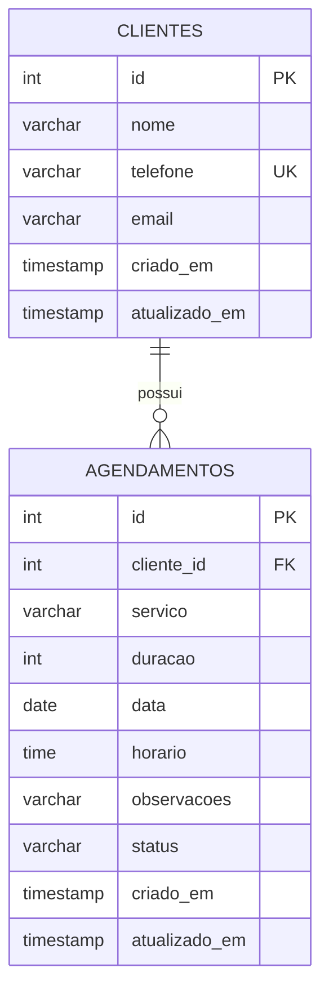

# Modelo do Banco de Dados - Etapa 07

## Escolha do banco

O AgendaFácil utiliza **PostgreSQL**, um banco de dados relacional. A escolha é adequada porque clientes e agendamentos possuem campos bem definidos e um relacionamento direto: cada agendamento pertence a um cliente. As chaves primária e estrangeira preservam a integridade dos dados.

O PostgreSQL também permite que os dados persistam após a API ser encerrada, algo que não ocorria quando a Etapa 06 utilizava arrays em memória.

## Diagrama de entidades e relacionamento

## Entidade Cliente

Representa a pessoa que contrata um serviço.

| Campo | Tipo PostgreSQL | Regra |
| --- | --- | --- |
| `id` | `SERIAL` | Chave primária gerada automaticamente. |
| `nome` | `VARCHAR(80)` | Obrigatório. |
| `telefone` | `VARCHAR(20)` | Obrigatório e único. |
| `email` | `VARCHAR(120)` | Opcional; salvo como texto vazio quando não informado. |
| `criado_em` | `TIMESTAMP` | Gerado pelo banco. |
| `atualizado_em` | `TIMESTAMP` | Atualizado pela API nas alterações. |

## Entidade Agendamento

Representa o atendimento marcado para um cliente.

| Campo | Tipo PostgreSQL | Regra |
| --- | --- | --- |
| `id` | `SERIAL` | Chave primária gerada automaticamente. |
| `cliente_id` | `INTEGER` | Chave estrangeira para `clientes.id`. |
| `servico` | `VARCHAR(80)` | Obrigatório. |
| `duracao` | `INTEGER` | De 15 a 480 minutos, em múltiplos de 15. |
| `data` | `DATE` | Obrigatória. |
| `horario` | `TIME` | Obrigatório. |
| `observacoes` | `VARCHAR(300)` | Opcional. |
| `status` | `VARCHAR(20)` | Confirmado, Concluido ou Cancelado. |
| `criado_em` | `TIMESTAMP` | Gerado pelo banco. |
| `atualizado_em` | `TIMESTAMP` | Atualizado pela API nas alterações. |

## Relacionamento

O relacionamento é **um para muitos**:

- Um cliente pode possuir zero, um ou vários agendamentos.
- Cada agendamento está ligado a exatamente um cliente.
- `agendamentos.cliente_id` referencia `clientes.id`.

A cláusula `ON DELETE RESTRICT` impede que o PostgreSQL remova um cliente que ainda tenha agendamentos. A API também verifica isso antes de executar a exclusão e retorna `409 Conflict` com uma mensagem clara.

## Arquivo de criação

As instruções SQL de criação estão em [../api/database/schema.sql](../api/database/schema.sql). Os dados fictícios iniciais estão em [../api/database/seed.sql](../api/database/seed.sql).
